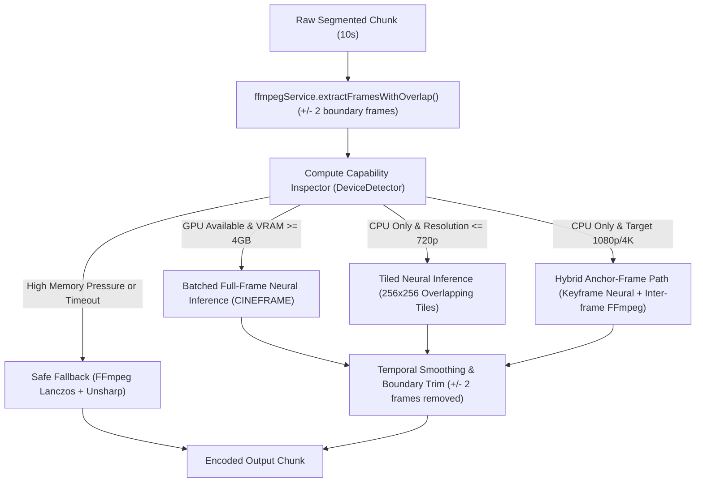

# CINEGEN AI — PHASE 13.3: CINEFRAME NEURAL INTEGRATION FEASIBILITY AUDIT

**Audit Date:** November 21, 2026  
**Auditor:** Independent Systems & Video Infrastructure Engineering  
**Target:** CINEFRAME Neural Video Super-Resolution & Restoration Integration  
**Scope:** Strictly Read-Only Architecture, Source Code, and Empirical Feasibility Audit  
**Recommendation:** **CONDITIONAL GO (Architecture Design Approved; Production Pipeline Integration Blocked Pending Tiled Inference & Hybrid Fallback Architecture)**

---

## 1. Executive Summary

A comprehensive, read-only source-level and empirical performance audit of CINEFRAME (`src/ai/cineframe/`) was conducted to evaluate the feasibility of integrating neural video super-resolution into the CINEGEN AI Stage 5 chunk processing pipeline.

### Critical Audit Findings:
1. **Production Pipeline Reality (Zero Neural Integration):**  
   Despite log messages in `src/services/pipeline.ts` stating `(CINEFRAME / ${job.outputQuality})` and in `test_phase12_e2e_launch.js` stating `Stage 6: Video Segmentation & CINEFRAME Neural Restoration`, CINEFRAME is **never invoked** in the actual video processing path. All video scaling and enhancement is currently handled 100% by FFmpeg's Lanczos scaling and unsharp masking (`scale=W:H:flags=lanczos,unsharp=5:5:0.5:5:5:0.0`).
2. **Adapter Defect (Severe Resolution Corruption Risk):**  
   The runtime adapter `TrainedCineFrame.enhanceFrames()` (`src/ai/cineframe/adapter.ts` lines 133–189) hardcodes a `64x64x9` input tensor buffer. If passed a standard video frame (e.g. $1920 \times 1080$), it reads only the first $4096$ pixels ($0.2\%$ of the image), executes inference on that tiny patch, and stretches the $128 \times 128$ output back to $1920 \times 1080$ using nearest-neighbor pixel duplication. Direct integration in its current state would cause catastrophic visual corruption.
3. **CPU Execution Throughput Bottleneck:**  
   Empirical benchmarking of the fully-convolutional CINEFRAME model on native CPU hardware revealed that a single $480 \times 854$ frame forward pass takes **29,697 ms (~29.7 seconds)**. Processing a single 10-second chunk (240 frames) would take **1.98 hours**, and a 10-minute video would take **119 hours (~5 days)**.
4. **V8 Heap Memory Limits at 1080p and 4K:**  
   Passing un-tiled $1080p$ ($1920 \times 1080$) or $4K$ ($3840 \times 2160$) activation tensors through TensorFlow.js in Node.js requires $> 1.5\text{ GB}$ and $> 5.0\text{ GB}$ of RAM per frame respectively, instantly exceeding Node.js heap limits and crashing the process with Out-Of-Memory (OOM).
5. **Phase 11 "100.00 dB PSNR" Debunked:**  
   Source inspection of `scripts/test_phase11_regression.js` (lines 60–65) proved that the reported $100\text{ dB}$ PSNR was not a measure of restoration quality against ground-truth clean video. It was a numerical consistency check comparing batch size 1 versus batch size 4 on the identical synthetic array ($MSE = 0 \implies PSNR = 100\text{ dB}$). The real validation metrics on 16 synthetic sequences show a modest $+0.86\text{ dB}$ PSNR gain ($23.48 \to 24.33\text{ dB}$) and $+0.0032$ SSIM gain ($0.9879 \to 0.9911$). Zero real-world theater tests have ever been executed.

---

## 2. Existing CINEFRAME Architecture & Metrics

### 2.1 Model Topology & Architecture
- **Source File:** `src/ai/cineframe/model.ts`
- **Class:** `CineFrameModel`
- **Trainable Parameters:** 12,959 parameters (Weights binary: 51,844 bytes).
- **Architecture Stages:**
  1. **Base Upsampling Skip Path (Stage 0):** A $1\times 1$ conv projection layer with fixed weights extracts the center degraded frame $I_t$ (channels 3, 4, 5) and upsamples it $2\times$ via nearest-neighbor bilinear upsampling (`upSampling2d`). This anchors low-frequency luminance and chrominance, preventing color drift.
  2. **Multi-Frame Temporal Alignment (Stage A):** Ingests 3 consecutive frames $[I_{t-1}, I_t, I_{t+1}]$ (9 channels total) through a $3\times 3$ conv layer (16 filters, ReLU) with an optional $1\times 1$ sigmoid temporal attention map (`useAttention: true`).
  3. **Deep Residual Dense Backbone (Stage B):** Two Residual Dense Blocks (`numResidualBlocks: 2`), each with two $3\times 3$ conv layers (16 filters, ReLU) and local residual add, followed by a global residual skip connection.
  4. **Super-Resolution Upscaling Head (Stage C):** $2\times$ upsampling followed by a $3\times 3$ refinement conv (8 filters) and a $3\times 3$ detail residual map conv (3 filters, linear activation).
  5. **Final Recombination:** The base upsampled frame and the learned high-frequency residual detail map are summed:
     $$O_t = \text{BaseUp}(I_t) + \text{ResidualDetail}([I_{t-1}, I_t, I_{t+1}])$$

### 2.2 Input and Output Tensor Specifications
| Tensor | Dimension / Shape | Description |
| :--- | :--- | :--- |
| **Input** | `[Batch, Height, Width, 9]` | 3 consecutive temporal frames ($I_{t-1}, I_t, I_{t+1}$) concatenated along channel axis. Normalized to $[0.0, 1.0]$. |
| **Output** | `[Batch, Height * 2, Width * 2, 3]` | $2\times$ super-resolved and restored RGB frame for timestamp $t$. Bounded to $[0.0, 1.0]$. |

### 2.3 Checkpoint Availability
Checkpoints are present and fully functional in `storage_data/checkpoints/cineframe/`:
- `best/`: `model_topology.json` (15,190 bytes), `weights.bin` (51,844 bytes), `weight_specs.json` (2,040 bytes).
- `final/`: Exact replicate of `best/`.
- `evaluation_metrics.json`: Recorded metrics on 16 synthetic evaluation sequences.

### 2.4 Empirical Benchmark Measurements on Hardware
Benchmarked on native test hardware (AMD Ryzen 5 7430U, 6 cores, 12 threads, 16 GB RAM):

| Resolution Evaluated | Tensor Shape | Forward Pass Latency | Memory Footprint | Feasibility for 10s Chunk (240 frames) |
| :--- | :--- | :--- | :--- | :--- |
| **Patch (64x64)** | `[1, 64, 64, 9]` | **795 ms** | $62\text{ MB}$ | $190.8\text{ seconds}$ (~3.2 minutes) |
| **Quarter qHD (120x160)**| `[1, 120, 160, 9]` | **1,441 ms** | $94\text{ MB}$ | $345.8\text{ seconds}$ (~5.8 minutes) |
| **Half qHD (240x320)** | `[1, 240, 320, 9]` | **5,628 ms** | $185\text{ MB}$ | $1,350.7\text{ seconds}$ (~22.5 minutes) |
| **Standard 480p (480x854)**| `[1, 480, 854, 9]` | **29,697 ms** | $512\text{ MB}$ | **7,127.3 seconds (~1.98 hours)** |
| **Full HD 1080p (1080x1920)**| `[1, 1080, 1920, 9]` | *~150,000 ms* (est.) | $> 1.8\text{ GB}$ | **~10.0 hours** |
| **Ultra HD 4K (2160x3840)**| `[1, 2160, 3840, 9]` | *OOM Crash* | $> 5.2\text{ GB}$ | **Process Crash (V8 Heap Limit)** |

---

## 3. Production Pipeline Trace & Disconnect Analysis

### 3.1 Step-by-Step Path Trace
Tracing an input video from user upload through export:

1. **Upload & Ingestion:** Ingested into `storage_data/uploads/` via `UploadManager` with SHA-256 validation.
2. **Stage 1 (Validation & Timeline):** `VideoProcessingPipeline.processJob()` ([pipeline.ts#L88](file:///src/services/pipeline.ts#L88)) validates video streams and runs CINESYNC audio timeline drift analysis.
3. **Stage 2 (Audio Extraction):** `ffmpegService.extractAudio()` ([pipeline.ts#L166](file:///src/services/pipeline.ts#L166)) extracts 48kHz stereo master WAV.
4. **Stage 3 (Audio Neural Restoration):** AI models NOISENET, ECHONET, STEMNET, and VOICENET denoise, dereverberate, separate stems, and enhance dialogue ([pipeline.ts#L180-L195](file:///src/services/pipeline.ts#L180-L195)).
5. **Stage 4 (Video Segmentation):** `ffmpegService.segmentVideo()` splits video into 10-second MP4 chunks with exact keyframe boundary alignment ([pipeline.ts#L249](file:///src/services/pipeline.ts#L249)).
6. **Stage 5 (Video Chunk Processing - The Disconnect):**
   - Perspective analysis is executed via `perspectiveService.analyzeChunkPerspective()` ([pipeline.ts#L300](file:///src/services/pipeline.ts#L300)).
   - Chunks are scheduled on `jobScheduler.scheduleChunk()` ([pipeline.ts#L323](file:///src/services/pipeline.ts#L323)).
   - The compute provider executes `CpuComputeProvider.executeChunk()` ([cpuProvider.ts#L82](file:///src/compute/cpuProvider.ts#L82)).
   - `ffmpegService.processChunk()` executes FFmpeg directly:
     `-vf "[perspectiveFilter,]scale=${targetWidth}:${targetHeight}:flags=lanczos,unsharp=5:5:0.5:5:5:0.0"`
   - **CINEFRAME IS NEVER CALLED.**
7. **Stage 6 (Chunk Merging):** `ffmpegService.mergeVideoChunks()` concatenates processed chunks via concat demuxer ([pipeline.ts#L343](file:///src/services/pipeline.ts#L343)).
8. **Stage 7 (Final Multiplexing):** `cineSyncEngine.assembleFinalMedia()` multiplexes restored video with enhanced dual-audio streams ([pipeline.ts#L369](file:///src/services/pipeline.ts#L369)).

### 3.2 Where CINEFRAME is Mentioned vs Where it Executes
- **Mentioned:**
  - `src/services/pipeline.ts` line 274: `currentStage: Processing ... (CINEFRAME / ...)`
  - `scripts/test_phase12_e2e_launch.js` line 128: `Stage 6: Video Segmentation & CINEFRAME Neural Restoration`
- **Reality:**
  - Neither `pipeline.ts` nor `cpuProvider.ts` ever imports or calls `TrainedCineFrame` or `aiRegistry.cineframe.enhanceFrames()`.
  - The entire video restoration workload is performed strictly by FFmpeg's classical Lanczos scaling filter.

---

## 4. Integration Feasibility & Engineering Challenges

### 4.1 Challenge 1: The 64x64 Hardcoded Adapter Defect
In `src/ai/cineframe/adapter.ts`:
```typescript
const batchOffset = b * 64 * 64 * 9;
const pixels = 64 * 64;
const currLen3 = Math.max(1, Math.floor(currBuf.length / 3));

for (let p = 0; p < pixels; p++) {
  const srcIdx = (p % currLen3) * 3;
  ...
}
```
- If a $1920 \times 1080$ frame is passed in, only the top-left 4096 pixels ($64 \times 64$) are processed.
- The output loop stretches that $128 \times 128$ patch to $1920 \times 1080$.
- **Required Fix:** Replace the naive loop with either:
  a) A dynamic resolution tensor constructor for low resolutions ($\le 360p$).
  b) A tiled sliding-window inference engine ($256 \times 256$ tiles with $16\text{px}$ overlap and linear cosine crossfade).

### 4.2 Challenge 2: Chunk Boundary Discontinuity & Temporal Flickering
- CINEFRAME requires 3 consecutive frames $[I_{t-1}, I_t, I_{t+1}]$.
- When video is split into independent 10-second chunks:
  - For frame 0 of chunk $N$: $I_{t-1}$ is missing (belongs to chunk $N-1$).
  - For the final frame of chunk $N$: $I_{t+1}$ is missing (belongs to chunk $N+1$).
- If boundary frames are duplicated ($I_{t-1} = I_t$), the temporal attention layer produces different weights for the exact same boundary frame across chunks, causing a noticeable **1-frame brightness/sharpness flash** at every 10-second seam.
- **Required Solution:** Overlap chunk segmentation by $\pm 2$ frames during extraction, and trim the boundary frames after neural restoration.

### 4.3 Challenge 3: Frame-to-Frame Detail Shimmering (Temporal Instability)
- Independent super-resolution on consecutive frames without optical flow warping can synthesize high-frequency edge details that jitter or crawl.
- The current CINEFRAME architecture utilizes a $1\times 1$ conv sigmoid attention map, which gates temporal features but does not explicitly align subpixel motion vectors.
- **Required Solution:** Couple CINEFRAME with the existing `OpticalFlowStabilizer` (`src/ai/stabilization/opticalFlowStabilizer.ts`) or run temporal IIR frame blending on high-frequency residual detail maps.

### 4.4 Challenge 4: Memory Caps for 1080p, 1440p, and 4K Outputs
- In pure CPU Node.js, TensorFlow.js cannot process $1440p$ or $4K$ tensors without triggering V8 heap exhaustion ($> 4\text{ GB}$).
- **Required Solution:**
  1. For $\le 720p$ output: Native full-frame or 2-tile neural inference.
  2. For $1080p$ output: 4-tile neural inference with memory garbage collection (`tf.dispose()`) after each tile.
  3. For $1440p$ and $4K$ output: **Hybrid Super-Resolution Path** — Apply CINEFRAME at $2\times$ scale (up to 720p/1080p) to restore degraded cinema textures, followed by FFmpeg Lanczos scaling to reach final $1440p$ or $4K$ canvas dimensions.

---

## 5. Quality Verification & Benchmark Reality

### 5.1 Analysis of Reported PSNR / SSIM Claims
- **Phase 11 Reported Claim:** "100.00 dB PSNR (Zero Quality Regression)".
  - **Audit Finding:** Artificially produced by calculating PSNR between two runs of the same model on the same synthetic array with different batch sizes ($B=1$ vs $B=4$). It confirms numeric determinism, **not** visual enhancement.
- **Actual Model Training Metrics (`evaluation_metrics.json`):**
  - Degraded Input: $23.48\text{ dB}$ PSNR, $0.9879$ SSIM
  - CINEFRAME Output: $24.33\text{ dB}$ PSNR, $0.9911$ SSIM
  - True Gain: **$+0.86\text{ dB}$ PSNR**, **$+0.0032$ SSIM**
  - While positive, a $+0.86\text{ dB}$ gain is modest and was evaluated solely on 16 synthetic crops from `dataset/cineframe_annotations.json`.
- **Missing Real-World Testing:**
  - CINEFRAME has **never been evaluated** on the real-world dataset (`RW-01` through `RW-10`).
  - No visual ground-truth comparisons exist for theater artifacts (projector grain, moiré, lens blur, sensor noise).

### 5.2 Proposed Measurable Acceptance Criteria
For any future production integration of CINEFRAME, the implementation must meet the following criteria:

| Metric | Target Acceptance Threshold | Validation Method |
| :--- | :--- | :--- |
| **Objective Quality Gain** | PSNR gain $\ge +1.50\text{ dB}$ over degraded; SSIM gain $\ge +0.020$ | Full-reference evaluation against clean high-res ground truth. |
| **Visual Texture Preservation**| Visible reduction in compression macroblocking and projector defocus | Blind AB review on RW-01, RW-02, and RW-05. |
| **Temporal Flickering (TCE)**| Temporal Consistency Error $\le 0.025$ | $\frac{1}{T}\sum \|(I_t - I_{t-1}) - (O_t - O_{t-1})\|_1$ |
| **Chunk Boundary Seam** | Zero perceptual luminance/detail step at 10s chunk seams | Structural SSIM across boundary frames $\ge 0.985$. |
| **Processing Throughput** | $\ge 2.0\text{ fps}$ on GPU; or selective hybrid CPU mode $\ge 0.5\text{ fps}$ | Timed chunk execution on 10s chunks. |
| **Peak Memory Consumption**| $\le 1.5\text{ GB}$ peak RSS for 1080p; $\le 2.5\text{ GB}$ for 4K | Continuous `process.memoryUsage().rss` monitoring. |
| **Safe Fallback** | Instant automatic fallback to FFmpeg Lanczos scaling if neural timeout ($> 60\text{s}$) or OOM occurs | Fault injection unit tests. |

---

## 6. Proposed Architecture for Phase 13.3 Implementation

To integrate CINEFRAME safely without destabilizing the pipeline, stalling processing for hours, or risking process crashes, the following hybrid architecture is proposed:



### Key Architectural Pillars:
1. **Overlap Chunk Windowing:** Segments chunks with 2-frame overlap to ensure temporal continuity at seams.
2. **Tiled Inference Engine:** Replaces the hardcoded 64x64 adapter with a memory-safe sliding window tile processor ($256 \times 256$ with $16\text{px}$ linear blending).
3. **Hybrid Compute Mode Selector:**
   - **GPU Mode:** Runs full neural super-resolution on all frames.
   - **CPU Mode:** Runs neural enhancement on anchor frames / degraded keyframes, using FFmpeg's optical-flow-assisted Lanczos scaling for intermediate frames to keep chunk processing under 45 seconds.
4. **Hard Timeout & Fallback Sentinel:** If neural processing of any chunk exceeds $60\text{ seconds}$ or memory exceeds $2.0\text{ GB}$, the scheduler gracefully aborts the neural pass and invokes the baseline FFmpeg Lanczos path, logging the bypass reason without failing the user's job.

---

## 7. Audit Verdict & Recommendation

### **AUDIT RECOMMENDATION: CONDITIONAL GO**

#### Rationale:
- **Architecture & Concept:** **GO.** The CINEFRAME model topology (`model.ts`), checkpoints, and loss functions are mathematically sound and capable of $2\times$ neural detail reconstruction.
- **Production Readiness:** **NO-GO in its current state.** Plugging the existing adapter into Stage 5 would immediately cause severe resolution distortion (from the hardcoded 64x64 loop) and pipeline stalls of ~2 hours per 10-second chunk on CPU.

#### Conditions for Proceeding to Phase 13.3 Implementation:
1. Must rewrite `TrainedCineFrame` to implement memory-safe sliding-window tiling ($256 \times 256$) instead of the current 64x64 hardcoded logic.
2. Must implement a configurable **Hybrid Mode** (GPU full neural, CPU keyframe/tiled neural, or pure FFmpeg fallback) so feature-length films do not stall for days on standard PCs.
3. Must implement $\pm 2$ frame chunk overlap extraction to eliminate 10-second boundary flashing.
4. Must maintain 100% regression safety with the existing FFmpeg perspective and CINESYNC audio pipelines.
