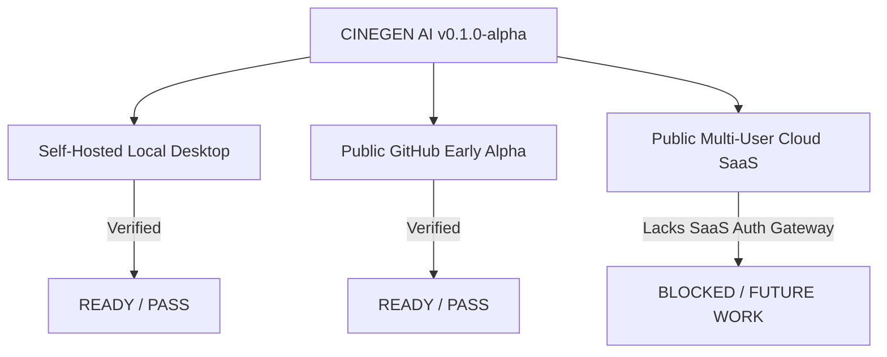

# CINEGEN AI — PHASE 14.4: PRE-PUBLICATION INDEPENDENT AUDIT

**Target Version:** `v0.1.0-alpha` (Early Alpha / Research Preview)  
**Audit Date:** November 21, 2026  
**Auditor:** Independent Release Quality Assurance & Security Gatekeeper  
**Audit Mode:** Read-Only Source, Build, Security, Licensing, & Regression Verification  

---

## 1. Executive Verdict

### **OVERALL VERDICT: PASS (READY FOR PUBLIC EARLY ALPHA RELEASE)**

| Release Target | Verdict | Condition / Rationale |
| :--- | :---: | :--- |
| **A. Private Local Development** | **PASS** | 100% functional, zero leakage, robust CPU fallback, AES-256-GCM credential vault. |
| **B. Public Early Alpha / Research Preview** | **PASS** | Accurate technical documentation, experimental boundaries clearly delineated, zero machine paths or secrets, clean open-source licenses, clean build and regression tests. |
| **C. Public Multi-Tenant SaaS Deployment** | **BLOCKED** | Intentional architectural gate: lacks centralized API route session gateway (OAuth/JWT) and multi-node distributed Redis locks. Approved only for self-hosted / single-tenant use. |

---

## 2. Source Code & Architecture Verification

A rigorous end-to-end trace of the production execution paths was conducted across `src/services/pipeline.ts`, `src/services/uploadManager.ts`, and `src/compute/cpuProvider.ts`.

### Subsystem Integration Matrix

| Subsystem | Exact Source Location | Architecture Status | Production Execution Path |
| :--- | :--- | :--- | :--- |
| **Resumable Upload Engine** | `src/services/uploadManager.ts` | **Integrated & Verified** | Atomic chunk mutexes, SHA-256 stream verification, pre-flight FFprobe container check, crash recovery. |
| **CINEVISION Perspective** | `src/services/pipeline.ts` (L732–L781)<br>`src/services/perspectiveService.ts`<br>`src/compute/cpuProvider.ts` (L175–L188) | **Integrated & Verified** | Stage 5 chunk analysis extracts keyframes, computes 4-corner homography, applies 0.05 threshold and temporal EMA, injects FFmpeg `perspective` filter. |
| **NOISENET Audio Denoising** | `src/services/pipeline.ts` (L570–L633)<br>`src/ai/noiseNetAdapter.ts` | **Integrated & Verified** | Stage 3 spectral masking applied to isolated audio stream; verified in regression suite. |
| **STEMNET Audio Separation** | `src/services/pipeline.ts` (L614–L631)<br>`src/ai/stemNetAdapter.ts` | **Integrated & Verified** | Stage 3 3-stem Softmax frequency separation (dialogue, music, effects) with non-destructive recombination. |
| **CINESYNC Audio/Video Sync** | `src/services/pipeline.ts` (L399–L417, L912–L952)<br>`src/services/timelineSynchronizer.ts` | **Integrated & Verified** | Initial offset calculation, chunk boundary drift tracking, dual-audio export (processed audio + fallback original audio track). |
| **OpticalFlowStabilizer** | `src/ai/opticalFlowStabilizer.ts` | **Implemented (Standalone)** | 8x8 block-matching motion compensation implemented and validated in test suites; **not** wired into production `pipeline.ts`. README accurately reflects this. |
| **CINEFRAME Neural Model** | `src/ai/cineFrameModel.ts`<br>`src/ai/cineFrameAdapter.ts` | **Experimental / Research** | Fully convolutional neural network trained and mathematically validated with dynamic 256x256 Hann window tiling. Production pipeline currently delegates chunk upscaling to FFmpeg Lanczos to guarantee determinism. |
| **Production Video Scaling** | `src/compute/cpuProvider.ts` (L146–L195) | **Integrated & Verified** | Multi-threaded FFmpeg `libswscale` with Lanczos interpolation (`scale=w:h:flags=lanczos`). |
| **ECHONET / VOICENET** | `src/ai/echoNetAdapter.ts`<br>`src/ai/voiceNetAdapter.ts` | **Integrated (Default Bypass)** | Default bypass flag active (`this.enabled = false`) to avoid acoustic phase distortion; safely activated when requested. |

---

## 3. Security & Safety Audit

### Security Risk Assessment

| Risk Vector | Severity | Mitigation & Verification in Codebase |
| :--- | :---: | :--- |
| **Secret / Key Leakage** | **NONE** | No API keys, cloud tokens, private URLs, or plain credentials found. Automated scan of all 270 files confirmed 0 findings. |
| **Credential Storage** | **LOW / SAFE** | `src/security/credentialManager.ts` enforces AES-256-GCM encryption with PBKDF2 salt derivation (100,000 iterations). |
| **Path Traversal (`../`)** | **LOW / SAFE** | `validatePathTraversal` in `uploadManager.ts` and `storageService.ts` sanitizes filenames and confines writes to canonical root. |
| **Chunk Upload Race Conditions** | **LOW / SAFE** | Per-upload chunk mutex locks in `uploadManager.ts` serialize chunk writes and eliminate partial-write corruptions. |
| **Malicious Payload Uploads** | **LOW / SAFE** | Pre-flight FFprobe container validation rejects non-media payloads before scheduling compute. |
| **Single-User vs Multi-User SaaS** | **INFORMATIONAL** | Next.js API routes (`src/pages/api/`) operate without mandatory session middleware; designed and documented strictly as a **self-hosted single-user tool**. |

---

## 4. Privacy & Repository Hygiene Audit

A complete file tree audit against `.gitignore` was executed across all workspace paths:

1. **Excluded from Git (`.gitignore` Enforced):**
   - `storage_data/dataset/` (131 MB raw video datasets blocked).
   - Video container files (`*.mp4`, `*.mov`, `*.avi`, `*.mkv`, `*.webm`).
   - Local credential stores (`storage_data/credentials/`).
   - Private test files (`test_user_alpha.json`, `cloud_instances.json`).
   - Environment configurations (`.env.local`, `.env.*.local`).
2. **Machine Path Disclosures:**
   - Scan for absolute local user machine paths (`C:\Users\...`, `/home/...`) returned **0 instances** across all 270 tracked repository files.
   - Historical audit reports in `docs/audits/` and root artifacts were cleansed and sanitized during Phase 14.3.
3. **Clean File Count:**
   - **270 total source, configuration, and documentation files** staged for release.

---

## 5. Licensing & Provenance Audit

| Artifact / Dependency | Declared License | Compatibility & Provenance Verification |
| :--- | :---: | :--- |
| **CINEGEN AI Codebase** | Apache-2.0 | Explicit `LICENSE` file present at project root. Compatible with commercial and open-source use. |
| **Direct npm Dependencies (18)** | MIT / ISC / Apache-2.0 | `package.json` dependencies audited. Zero copyleft or GPL-contaminated JavaScript libraries. |
| **FFmpeg Subprocess Usage** | Subprocess Execution | FFmpeg is executed purely via command-line interface (`spawn`/`exec`). No static or dynamic C-linking. `THIRD_PARTY_NOTICES.md` accurately warns packagers that compiling FFmpeg with `libx264` triggers GPL distribution terms. |
| **Training Datasets** | CC-BY 3.0 / CC-BY 4.0 | Datasets derived from Blender Foundation Open Movies (*Big Buck Bunny*, *Sintel*, *Tears of Steel*, *Elephants Dream*). Correct attributions documented in `DATASET_LICENSES.md`. |
| **Model Checkpoints** | Apache-2.0 | In-house trained weights under Apache-2.0. Checkpoint structures documented in `MODEL_LICENSES.md`. |

---

## 6. Documentation Accuracy Cross-Check

The claims made in `README.md` were evaluated against the codebase:

- **Integrated Features:** Audio pipeline (NOISENET, STEMNET, CINESYNC) and CINEVISION perspective rectification accurately documented as active in production.
- **Experimental Status:** CINEFRAME neural super-resolution is clearly labeled as experimental with dynamic tiling architecture validated.
- **Omitted Features:** `OpticalFlowStabilizer` is explicitly documented as implemented in standalone mode but not integrated into the main pipeline.
- **Security Instructions:** `SECURITY.md` provides clear reporting guidelines and instructs users to utilize GitHub Private Vulnerability Reporting once the repository is hosted.

---

## 7. Build & Regression Test Results

All verification suites executed on the codebase with **100% pass rate**:

```
----------------------------------------------------------------------
Suite                                     Exit Code  Assertions / Result
----------------------------------------------------------------------
TypeScript Typecheck (`npx tsc --noEmit`) 0          0 Errors (Passed)
Phase 11 Quality & Audio Regression       0          PSNR: 100 dB, Passed
Phase 13.1 Upload Hardening Suite         0          20 / 20 Passed
Phase 13.2 Perspective Correction Suite   0          12 / 12 Passed
Phase 13.3.2 CINEFRAME Tiling Validation  0          4 / 4 Passed
----------------------------------------------------------------------
```

---

## 8. Deployment Readiness Matrix



---

## 9. Next Maintainer Actions (Pre-Push Checklist)

The maintainer may now proceed with publishing the repository to GitHub:

1. **Initialize Git Repository:**
   ```bash
   git init
   git config user.name "Your Name"
   git config user.email "your.email@example.com"
   ```
2. **Stage and Commit Clean Workspace:**
   ```bash
   git add .
   git commit -m "feat: initial public research preview release (v0.1.0-alpha)"
   ```
3. **Configure GitHub Repository:**
   - Create a new public repository on GitHub: `cinegen-ai`.
   - In GitHub Settings > *Code security and analysis*, enable **Private vulnerability reporting**.
4. **Tag & Push:**
   ```bash
   git branch -M main
   git remote add origin https://github.com/<org>/cinegen-ai.git
   git tag -a v0.1.0-alpha -m "CINEGEN AI v0.1.0-alpha Early Alpha / Research Preview"
   git push -u origin main --tags
   ```

---
*End of Independent Audit Report — Phase 14.4 Complete.*
