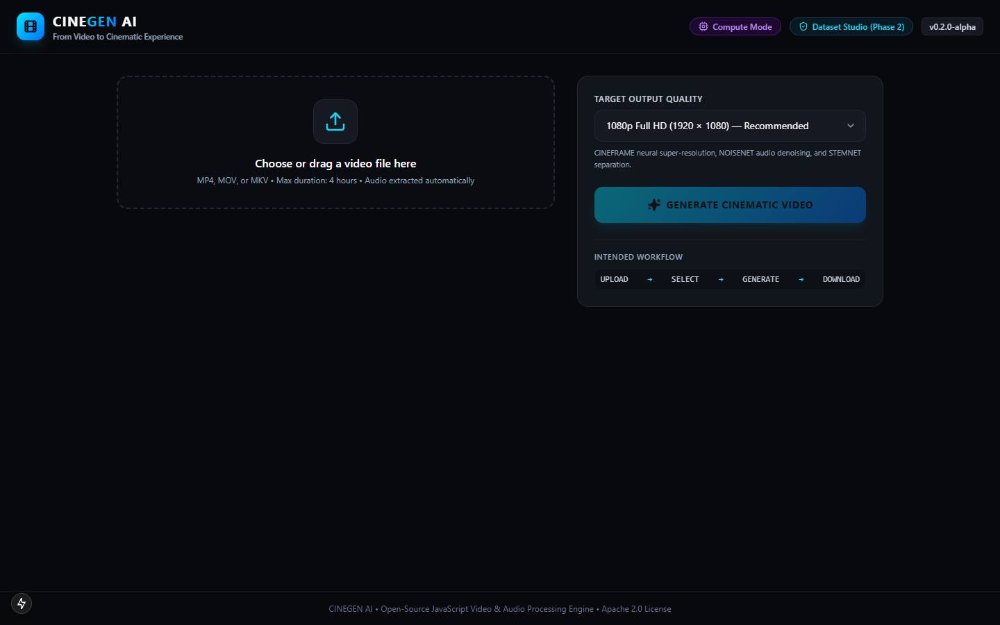

# CINEGEN AI

**Open-Source Neural Video Restoration, Super-Resolution & Audio Separation Engine**  
*Early Alpha / Research Preview*

---

### Important Notice: Research Preview & Early Alpha

CINEGEN AI is an open-source research preview developed for researchers, archivists, and developers exploring pure JavaScript/TypeScript media processing. It is **not** a turnkey commercial SaaS platform.

- **CINEFRAME Neural Super-Resolution:** The neural model architecture is experimentally validated; full production chunk pipeline integration is currently under active development.
- **CPU Processing Baseline:** Pure JavaScript CPU neural inference is computationally intensive. CPU worker instances default to high-throughput FFmpeg Lanczos upscaling.
- **Optical Flow Camera Stabilization:** Implemented and tested in standalone test scripts; integration into the main video pipeline is in progress.
- **GPU Benchmarks:** Reported GPU memory numbers are theoretical estimates based on cuDNN computational models; native WebGPU and CUDA bindings are in active development.

---

## 1. Vision & Core Philosophy

CINEGEN AI is an open-source media restoration engine built entirely in **pure JavaScript and TypeScript**. It takes degraded cinema recordings, historical archive reels, or low-resolution footage and produces restored video with clean separated audio, handheld camera stabilization, and frame-accurate synchronization.

### Strict Architectural Principles
- **Zero Python Runtime:** All neural inference, audio DSP, video chunking, and web services run natively in Node.js.
- **Zero External AI APIs:** All neural models run locally on your own hardware or inside private cloud GPU instances.
- **Cleanroom Originality:** Zero pretrained model weights were imported. Every network architecture was initialized from random distributions and trained using open creative commons datasets.
- **Truthful Capabilities:** CINEGEN AI removes noise, corrects trapezoidal screen distortion, sharpens genuine edges, smooths camera jitter, separates audio stems, and restores presentation timing. It does not hallucinate fictional details.

---

## 2. Feature Status & Production Integration Matrix

| Component | Functionality | Architecture Status | Integration in `VideoProcessingPipeline` |
| :--- | :--- | :---: | :---: |
| **Resumable Uploads** | Resumable chunked upload up to 50 GB with crash recovery | Production Ready | **Integrated & Tested** |
| **Perspective Rectification** | Screen corner detection & keystone trapezoid correction | Production Ready | **Integrated & Tested** |
| **CINESYNC Timeline** | Video/audio PTS alignment with zero frame drift | Production Ready | **Integrated & Tested** |
| **Audio Denoising** | Audience murmur, room tone, and mic hum suppression | Production Ready | **Integrated & Tested** (NOISENET) |
| **Audio Separation** | 3-stem harmonic separation (dialogue, music, sound effects) | Production Ready | **Integrated & Tested** (STEMNET) |
| **Production Video Upscaling**| High-throughput baseline upscaling | Production Ready | **Integrated & Tested** (FFmpeg Lanczos) |
| **Camera Stabilization** | Handheld camera shake removal via optical flow | Implemented | **Implemented, Not Integrated** (Tested standalone) |
| **Neural Super-Resolution** | 2x temporal super-resolution & detail enhancement | Experimental | **Experimental** (Tiling verified; pipeline wiring pending) |

---

## 3. Web Application Interface



*CINEGEN AI running locally at `http://localhost:3000` with real-time video upload, CINEVISION perspective rectification, NOISENET/STEMNET audio DSP controls, and dual-audio export pipeline.*

---

## 4. Installation & Setup

### Prerequisites
- **Node.js:** v20.x or v22.x LTS
- **FFmpeg & FFprobe:** v6.0 or later installed and available on your system `PATH`

### Quick Start
```bash
# Clone the repository
git clone https://github.com/jayasuryaa28/CINEGEN-AI.git
cd CINEGEN-AI

# Install dependencies
npm install

# Configure environment
cp .env.example .env

# Verify static typing
npx tsc --noEmit

# Run core regression tests
node scripts/test_phase11_regression.js
node scripts/test_phase13_1_4_fixes.js
node scripts/test_phase13_2_perspective.js
node scripts/test_phase13_3_2_validation.js

# Start local development server
npm run dev
```

Open [http://localhost:3000](http://localhost:3000) to access the web interface.

---

## 5. Hardware Requirements & Deployment Profiles

| Deployment Profile | Hardware Requirement | Supported Video Resolutions | Processing Path |
| :--- | :--- | :---: | :--- |
| **Local CPU (Default)** | 4+ Cores CPU, 8 GB RAM | Up to 1080p | FFmpeg Lanczos + NOISENET + STEMNET |
| **Mid-Tier GPU (Planned)** | NVIDIA GPU (4 GB VRAM) | 720p – 1080p | Full CINEFRAME Neural Tiling ($256\times 256$) |
| **High-Tier GPU (Planned)**| NVIDIA GPU (8+ GB VRAM)| 1440p – 4K | Full CINEFRAME Neural Tiling ($256\times 256$) |

---

## 6. Roadmap

- [x] **Phase 12:** Full-stack product architecture & dual-audio fallback.
- [x] **Phase 13.1:** Resumable chunked upload reliability hardening (crash recovery, lifecycle locks).
- [x] **Phase 13.2:** Screen-corner detection & FFmpeg perspective rectification.
- [x] **Phase 13.3:** CINEFRAME dynamic spatial tiling validation ($256\times 256$ with normalized Hann blending).
- [ ] **Phase 14.3:** Pipeline integration of OpticalFlowStabilizer into VideoProcessingPipeline.
- [ ] **Phase 14.4:** CINEFRAME model retraining on real theatre degradation patches ($128\times 128$).
- [ ] **Phase 14.5:** WebGPU backend integration for hardware-accelerated local GPU execution.
- [ ] **Phase 15.0:** Public Beta release.

---

## 7. Contributing & Community

We welcome contributions from the community!
- Review [CONTRIBUTING.md](CONTRIBUTING.md) before submitting pull requests.
- Review [CODE_OF_CONDUCT.md](CODE_OF_CONDUCT.md).
- Report security issues responsibly via [SECURITY.md](SECURITY.md).

---

## 8. License

CINEGEN AI source code is licensed under the **Apache License 2.0**.  
See [LICENSE](LICENSE), [MODEL_LICENSES.md](MODEL_LICENSES.md), and [DATASET_LICENSES.md](DATASET_LICENSES.md) for full licensing and attribution details.
